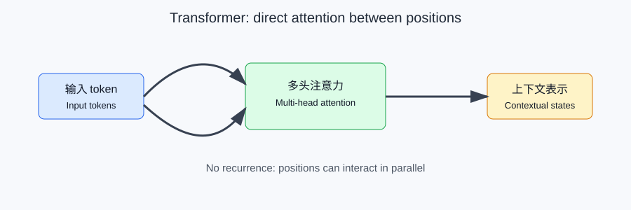
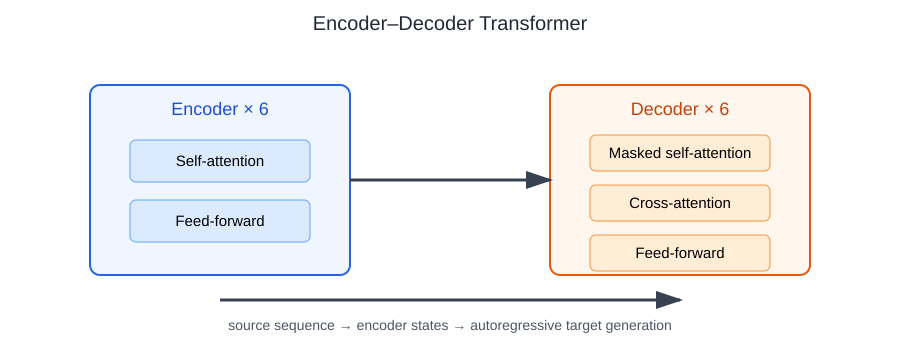
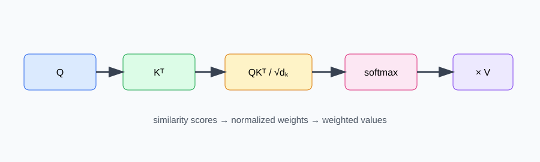
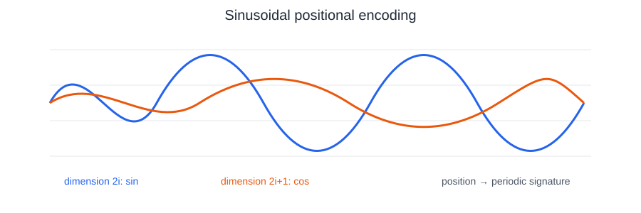

# Attention Is All You Need：中英双语精读与可运行复现

> **论文题目 / Paper**: *Attention Is All You Need*  
> **作者 / Authors**: Ashish Vaswani, Noam Shazeer, Niki Parmar, Jakob Uszkoreit, Llion Jones, Aidan N. Gomez, Lukasz Kaiser, Illia Polosukhin  
> **会议 / Venue**: NeurIPS 2017  
> **论文编号 / Identifier**: [arXiv:1706.03762](https://arxiv.org/abs/1706.03762)  
> **本文性质 / Nature of this file**: 双语学习版释义、公式解释和缩小版实验复现；不是论文全文逐句翻译。

## 1. 论文要解决什么问题 / What problem does the paper address?

### 中文释义

在 Transformer 之前，机器翻译常用 RNN 或 CNN 编码器-解码器。RNN 按时间步处理序列，难以并行；长距离依赖也会让信息传递变困难。论文提出 Transformer：完全依靠注意力机制建模序列关系，去掉循环结构和卷积结构。

### English paraphrase

Before the Transformer, sequence-to-sequence translation commonly relied on recurrent or convolutional encoder-decoder networks. Recurrence limits parallel computation, while long-range dependencies require information to travel through many steps. The paper introduces the Transformer, an architecture that models relationships with attention instead of recurrence or convolution.

### 一句话贡献 / One-sentence contribution

**中文**：把“序列按顺序处理”改成“序列位置之间直接建立加权联系”。  
**English**: Replace step-by-step sequence processing with direct, weighted interactions between positions.



## 2. Transformer 总体结构 / Overall architecture

### 中文释义

Transformer 是一个编码器-解码器（encoder-decoder）模型：

- 编码器读取源语言序列，生成上下文表示。
- 解码器根据编码器表示和已经生成的目标序列，逐词生成输出。
- 编码器和解码器都由多个相同结构的层堆叠而成。
- 基础模型（Base）使用 6 层编码器和 6 层解码器，模型维度 `d_model = 512`。

### English paraphrase

The Transformer is an encoder-decoder model. The encoder converts the source sequence into contextual representations. The decoder generates the target sequence autoregressively, using both encoder outputs and previously generated target tokens. Each side is a stack of identical layers; the base configuration uses six encoder layers and six decoder layers with `d_model = 512`.



### 一层编码器与解码器 / One encoder layer and one decoder layer

**编码器层 / Encoder layer**

1. 多头自注意力（multi-head self-attention）
2. 残差连接（residual connection）和 LayerNorm
3. 逐位置前馈网络（position-wise feed-forward network）
4. 残差连接和 LayerNorm

**解码器层 / Decoder layer**

1. 带因果遮罩的自注意力，不能看未来 token
2. 对编码器输出的交叉注意力（cross-attention）
3. 逐位置前馈网络
4. 每个子层外都有残差连接和 LayerNorm

The encoder layer contains self-attention and a feed-forward network. The decoder adds masked self-attention and encoder-decoder attention. Residual connections and layer normalization surround every sub-layer.

## 3. Scaled Dot-Product Attention

### 公式 / Formula

$$
\operatorname{Attention}(Q,K,V)=\operatorname{softmax}\left(\frac{QK^T}{\sqrt{d_k}}\right)V
$$

### 中文逐项解释

- `Q`（query）：当前位置想查询什么。
- `K`（key）：每个位置可以被匹配的特征。
- `V`（value）：真正被加权汇总的信息。
- `QK^T`：计算查询与各个 key 的相似度。
- `\sqrt{d_k}`：缩放点积，避免维度变大后 softmax 过于尖锐。
- `softmax`：把分数变成权重，权重总和为 1。
- 乘以 `V`：按注意力权重混合各位置的信息。

### English paraphrase

Queries are compared with keys through a dot product. The scores are scaled by the square root of the key dimension, normalized with softmax, and used to compute a weighted sum of values. The result is a context-aware representation for every query position.



### 一个小例子 / A small example

如果句子中的“它”需要判断指代对象，`Q` 可以代表“它”的查询，相关名词的 `K` 会得到更高分，最终对应的 `V` 会被更大权重写入“它”的新表示。注意力不是简单选择一个词，而是对多个位置做加权组合。

If a token needs to resolve a reference, its query can assign larger weights to keys belonging to relevant nouns. The output is a weighted combination of value vectors rather than a hard selection of one token.

## 4. Multi-Head Attention

### 中文释义

多头注意力把输入分别投影到多个子空间，每个 head 独立计算注意力，最后拼接并再次线性投影。不同 head 可以学习不同关系，例如短语结构、指代关系或局部邻接关系。

### English paraphrase

Multi-head attention projects the inputs into several lower-dimensional subspaces. Each head computes attention independently; the head outputs are concatenated and linearly projected. Different heads can specialize in different syntactic or semantic relationships.

$$
\operatorname{MultiHead}(Q,K,V)=\operatorname{Concat}(head_1,\ldots,head_h)W^O
$$

$$
head_i=\operatorname{Attention}(QW_i^Q,KW_i^K,VW_i^V)
$$

在 Base 模型中通常使用 `h = 8` 个 head，每个 head 的维度约为 `64`，因为 `8 × 64 = 512`。

The base model uses eight heads with a head dimension of approximately 64, so the concatenated representation has dimension 512.

## 5. 为什么需要位置编码 / Why positional encoding is needed

### 中文释义

注意力本身可以同时处理所有位置，但它不会天然知道 token 的先后顺序。论文把位置编码加到 token embedding 上，让模型同时看到词的语义表示和位置信息。

### English paraphrase

Attention can process all positions in parallel, but attention alone does not encode token order. Positional encodings are added to token embeddings so that the model receives both semantic and positional information.

论文使用正弦和余弦函数：

$$
PE_{(pos,2i)}=\sin\left(pos/10000^{2i/d_{model}}\right)
$$

$$
PE_{(pos,2i+1)}=\cos\left(pos/10000^{2i/d_{model}}\right)
$$

不同维度使用不同频率，位置之间形成规律性的向量差异。正弦位置编码也可以外推到训练时没有出现过的更长序列，但实际外推能力仍取决于模型和任务。

Different dimensions use different frequencies, creating a structured signature for each position. Sinusoidal encodings can be evaluated at positions beyond the training range, although useful extrapolation still depends on the model and task.



## 6. Mask、残差和前馈网络 / Masking, residuals, and feed-forward layers

### Causal mask

**中文**：解码器生成第 `t` 个 token 时，不能读取第 `t+1` 个及之后的目标 token；遮罩把这些位置的注意力分数设为负无穷，softmax 后权重接近 0。  
**English**: When generating target position `t`, the decoder must not read positions after `t`. The causal mask assigns those logits negative infinity, making their softmax weights effectively zero.

### Position-wise feed-forward network

$$
FFN(x)=\max(0,xW_1+b_1)W_2+b_2
$$

**中文**：注意力负责跨位置交换信息，前馈网络在每个位置独立地做非线性变换。  
**English**: Attention exchanges information across positions, while the feed-forward network applies a nonlinear transformation independently at each position.

### Residual connection and LayerNorm

残差连接让子层学习“在输入基础上需要增加什么”，LayerNorm 让训练更稳定。二者共同帮助深层堆叠优化。

Residual connections let each sub-layer learn an update to its input, while LayerNorm stabilizes the activations and optimization.

## 7. 训练目标与推理 / Training objective and inference

### 中文释义

训练时使用 teacher forcing：解码器输入目标序列的右移版本，预测下一个 token。损失通常是 token-level cross-entropy，并配合 label smoothing。推理时不能看到真实目标序列，只能根据已经生成的前缀逐步生成；因此训练可以并行，生成阶段仍具有自回归特性。

### English paraphrase

During training, teacher forcing feeds the decoder a right-shifted target sequence and trains it to predict the next token with token-level cross-entropy, together with label smoothing in the paper. During inference, the target sequence is unavailable, so tokens are generated autoregressively from the generated prefix. Training is highly parallel, while decoding remains sequential.

## 8. 论文主要实验 / Main experiments in the paper

### 论文报告的实验设置 / Reported setup

论文主要在 WMT 2014 English-German 和 English-French 机器翻译任务上比较 Transformer、循环模型和卷积模型。报告的重点是：

- 翻译质量：BLEU 分数。
- 训练成本：训练时间和计算资源。
- 并行效率：序列位置之间不需要循环传递。
- 消融分析：不同注意力结构、层数和位置编码的影响。

The paper evaluates translation on WMT 2014 English-German and English-French tasks. It reports BLEU quality, training cost, parallelization benefits, and ablations of architectural choices.

### 结果如何理解 / How to interpret the results

论文的核心实验结论不是“注意力在所有任务上永远最好”，而是：在当时的机器翻译设置下，Transformer 在较低训练成本和更强并行性的条件下取得了有竞争力或更好的 BLEU。复现时必须固定数据、分词、模型配置、训练步数、随机种子和硬件，否则分数不能直接比较。

The central claim is conditional: under the paper's translation settings, the Transformer achieved strong BLEU with better parallelism and lower training cost than the compared systems. A meaningful reproduction must control data, tokenization, model configuration, training steps, random seeds, and hardware.

## 9. 本文件中的缩小版复现 / Scaled reproduction in this folder

完整复现 WMT14 和论文中的训练规模需要原始数据、分词工具、长时间训练和相近硬件；本文件夹提供一个可在你的 GPU 虚拟环境运行的教学复现：

1. 使用 PyTorch 的 Transformer encoder-decoder。
2. 在固定随机种子的合成序列任务上训练。
3. 记录 CPU/GPU、参数量、训练损失、验证准确率和推理样例。
4. 对比 causal mask 是否生效，以及模型能否学会序列复制。

This folder contains a reproducible educational experiment rather than a claim of reproducing the original WMT14 BLEU numbers. It uses a PyTorch Transformer on a deterministic synthetic sequence-to-sequence task and records hardware, parameter count, loss, validation accuracy, and predictions.

运行脚本：`reproduce_transformer.py`。推荐在课程根目录执行：

```powershell
Set-Location 'H:\论文学习\agent\xuexi'
.\.venv\Scripts\python.exe -X utf8 '.\论文_Attention_Is_All_You_Need_中英双语精读\reproduce_transformer.py' --device cuda
```

如果 CUDA 不可用，脚本会报告设备状态并可以改用 `--device cpu`；这不等于完成论文原始规模复现。

### 本次 GPU 实际运行 / Actual GPU run

运行命令：

```powershell
.\.venv\Scripts\python.exe -X utf8 '.\论文_Attention_Is_All_You_Need_中英双语精读\reproduce_transformer.py' --device cuda --steps 1500
```

实际环境和结果：

```json
{
  "device": "cuda",
  "torch_version": "2.11.0+cu128",
  "gpu": "NVIDIA GeForce RTX 3070 Ti Laptop GPU",
  "seed": 2026,
  "steps": 1500,
  "parameters": 172448,
  "initial_loss": 3.63002,
  "final_loss": 0.00366,
  "token_accuracy": 1.0,
  "sequence_accuracy": 1.0,
  "seconds": 18.401
}
```

这说明小模型已经学会“复制输入并在末尾生成 EOS”这个合成任务。它验证了 Transformer 的编码器、解码器、位置嵌入和目标端因果遮罩能够组成可训练的序列到序列模型；它没有复现 WMT14 的数据、BLEU 或论文中的训练规模。

This run shows that the small model learned the synthetic copy task. It validates the trainable encoder-decoder mechanism, positional embeddings, and target-side causal masking, but it does not reproduce the paper's WMT14 data, BLEU scores, or training scale.

## 10. 复现结果应记录什么 / What to record

| 项目 / Item | 记录内容 / Record |
|---|---|
| 环境 / Environment | Python、PyTorch、GPU 名称、CUDA 版本 |
| 数据 / Data | 合成任务规则、训练/验证样本数、随机种子 |
| 模型 / Model | 层数、`d_model`、head 数、FFN 维度、参数量 |
| 训练 / Training | batch size、学习率、epoch、耗时、最终 loss |
| 结果 / Result | 验证准确率、预测样例、mask 实验结果 |
| 限制 / Limits | 与 WMT14、BLEU 和论文训练规模的差异 |

## 11. 参考资料与图片来源 / Sources

- Vaswani et al., *Attention Is All You Need*, [arXiv:1706.03762](https://arxiv.org/abs/1706.03762)。
- 原论文 PDF：[arXiv PDF](https://arxiv.org/pdf/1706.03762)。
- 多头注意力公开图示：[Wikimedia Commons](https://commons.wikimedia.org/wiki/File:Attention_Is_All_You_Need_-_Multiheaded_Attention.png)。
- 本目录 `images/` 中的 SVG 是根据论文机制重新绘制的学习示意图，不是论文原图的像素复制。

## 12. 使用边界 / Scope note

本文用双语释义帮助理解论文，不替代原论文，也不声称复现论文全部 BLEU 结果。正式引用、实验数字和方法细节应回到原论文核对。
